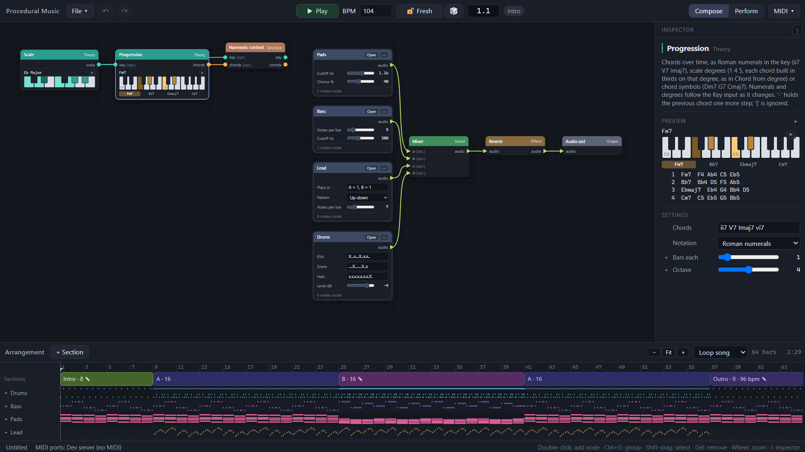
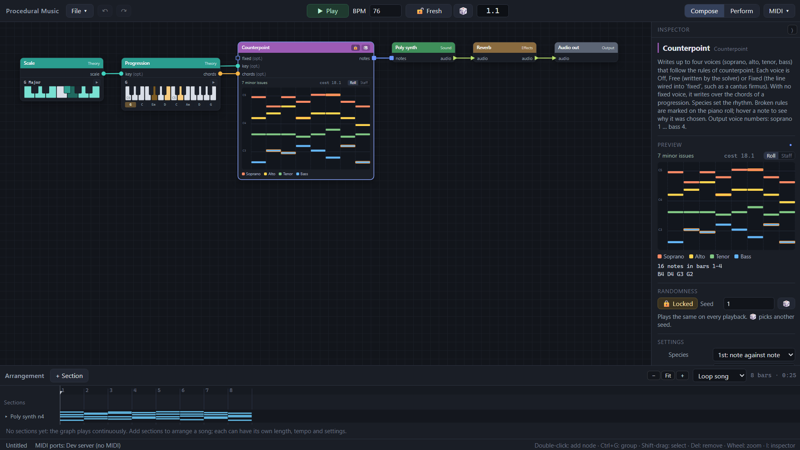

# Procedural Music

A desktop app for making music by wiring up music theory.

In Procedural Music, scales, chords, progressions and rhythms are values that flow along
typed wires between nodes. Nodes transform them (change mode, voice-lead, substitute,
syncopate), turn them into notes (arpeggios, basslines, random walks, Markov melodies,
four-part counterpoint), and play the result through built-in synths and drums or send
it to your MIDI gear. Every node shows a live preview of what it's producing, so the
theory is something you can see and hear at each step, not just the end result.

It's generative but repeatable: random parts play something new on every pass until you
like what you hear, and then you lock them. And it's live: the graph is evaluated just
ahead of the playhead, so you can rewire and retune while the music plays.



**Highlights**

- **Theory you can see and hear.** Keys, modes and custom scales; progressions in Roman
  numerals, scale degrees or chord symbols; voicings and voice leading; extensions,
  substitutions, modal borrowing and secondary dominants. Click any preview to hear it.
- **One harmony, many parts.** A Harmonic context node carries the song's key and chords
  to every part that doesn't have its own, so a bassline, pads and a lead follow the same
  progression without a tangle of wires.
- **Counterpoint with explanations.** A solver writes up to four voices by the rules of
  species counterpoint, and shows which rules each note bends and why it won over the
  next-best choice.
- **Whole songs.** Parts become groups, sections arrange them on a timeline with their
  own tempos and settings, and Perform mode cues sections live.
- **Theory views.** Circle of fifths, Tonnetz and interval matrix nodes follow the
  harmony as it plays.
- **Sound and MIDI.** Built-in poly, mono and drum synths with effects, or MIDI out per
  part, with CC, clock in and out, and latency compensation. Export to WAV or a
  standard MIDI file.

The design and its reasoning are in [DESIGN.md](DESIGN.md).

## Getting started

You need a Rust toolchain and the system libraries Tauri uses
([Tauri prerequisites](https://v2.tauri.app/start/prerequisites/)). The app is developed
and tested on Windows.

```
cargo run --manifest-path app/Cargo.toml
```

The first build downloads and compiles Tauri, which takes a few minutes.

Then:

- **File ▾ › Examples** loads the demo patches: *Full song*, *Modal explorer*,
  *Progression to pads*, *Full band*, *First species*, *Chorale* (all on the built-in
  synths) and *Full band (MIDI)*. Press **Space** to play.
- **File ▾ › New song** starts from a template: drums, bass, pads and lead as groups,
  following one key and progression, with a short arrangement. **New empty patch** gives
  a blank canvas.

The examples play through the built-in instruments on your default audio output.

## Using the editor

### Building a patch

- Double-click the canvas (or press Tab) to add a node; type to search.
- Drag from an output dot to an input dot to connect. Drop a wire on empty canvas to get
  a menu of nodes that accept it. Drag a connected input's dot to move or remove its wire.
- Port colors: scale (teal), chord (amber), rhythm (pink), notes (blue), audio (lime
  triangles), control (violet triangles). A chord wired into a scale input is converted
  automatically (shown with a badge on the wire). Sound chains run instrument → effects →
  Mixer → Audio out.
- Nodes are compact: a title, ports, and a red ! when something is wrong. Select one to see
  everything about it in the **inspector** on the right (I shows or hides it): its help,
  problems, a live preview of its output and all its settings.
- Previews draw scales and chords on a keyboard (a progression also gets a strip of its
  chords; hover one to see it), rhythms as a step grid, notes as a small piano roll and
  controls as a curve. They show what is playing: the 4 bars around the playhead, in the
  section playing, with its random choices and automation. Stopped, they show where Play
  will start, with what was last heard.
- **Pin** (●) the preview or a setting in the inspector to show it on the node too. Source
  nodes (Scale, Pattern, LFO…), Progression, Counterpoint and analysis nodes show their
  preview by default.
- To hear a scale, chord, progression or rhythm without wiring it up, click ▶ on its
  preview or click the name of its output. A scale plays as a run, chords as blocks and
  a rhythm as clicks, through a preview instrument, even while the song plays.
- Hover a wire to see what it carries: the value on that output, drawn like a preview,
  with its text. Wires into and out of groups show the value from the node that makes it.
- Edits apply while playing. Ctrl+S saves a `.pmpatch` file, and the current patch is
  also autosaved between sessions.

### Harmony

- A **Harmonic context** node sets the song's key and chords: any scale or chord input
  left unwired anywhere (inside groups too) reads them, shown as "(context)" on the port.
  A wire always wins. The Song template feeds it from a key (a Scale node) and a
  Progression, so Bass, Pads and Lead follow along without wires.
- A **Progression** reads Roman numerals or scale degrees ("1 4 5", as triads, 7ths or 9ths)
  in the key wired into its Key input (a Scale node, or the Harmonic context); change the
  key and the chords follow. Chord symbols need no key.
- A Scale node set to **Custom** gets a one-octave picker for its notes.

### The nodes

| Family | Nodes |
| --- | --- |
| **Harmony** (in the key: the key input, or the Harmonic context) | *Chord from degree* builds the chord on a degree (pin the degree and drive it with Steps to write a progression). *Extend* stacks 7ths to 13ths. *Substitute* swaps in tritone, relative or parallel chords. *Borrow* takes chords on chosen degrees from a parallel mode (iv, ♭VI, ♭VII). *Secondary dominant* slips V7 of each target chord in before it. *Transpose* moves chords by semitones or by scale steps, *Transpose key* moves a scale, and *Scale set* intersects, joins or subtracts two scales. |
| **Voicing** | *Voice*, *Voice lead*, *Drop voicing*, *Invert*, *Spread* (bass kept, the rest spread over some octaves) and *Close / open*. |
| **Melody** (one note per rhythm hit) | The *Arpeggiator* runs through each chord's tones. *Degree sequencer*, *Random walk*, *Markov* (learns which degree follows which from a melody, typed as degrees or wired into Train, and improvises in its style) and *Contour* (a line that rises, falls, arches or waves over each phrase) play from a scale. *Motif transform* plays each phrase of a melody backwards, upside down (in the key), stretched or squeezed. |
| **Rhythm** | *Pattern*, *Euclidean*, *Polyrhythm* (3 against 4 and the like), *Combine* (or, and, xor, A not B, and Drop, which turns A's hits where B hits into dropped hits), *Rotate*, *Subdivide* (ratchets), *Swing*, *Accent* (an accent pattern over the hits) and *Probability* (each hit plays with some chance, rolled again every pass; unwired, it thins out sixteenths). A **dropped hit** (`o` in a Pattern) doesn't play but still counts as a hit, so a Degree sequencer steps past it rather than waiting; a hit that loses its roll works the same way. Combining keeps the rolls: And plays exactly where both rhythms play. Hits with a chance show faded in the step grid, dropped hits as outlines. |
| **Notes** | *Octave*, *Quantize to scale*, *Velocity* (with a curve), *Humanize* (small random timing and loudness), *Legato* (hold each note to the next), *Note delay* (with echoes), *Note filter*, *Rhythm gate* (and/or/xor/drop notes with a rhythm's hits, like Combine, or replace their rhythm), *Split by range*, *Repeat bars* (loop the first bars of every block into a riff), *Merge* and *Split voices*. *Harmonizer* adds a parallel third or sixth in the key. |
| **Analysis** (follow the harmony as it plays; unwired, they show the Harmonic context) | *Circle of fifths* (the key on the rim, the chord as a shape, the path of the roots), *Tonnetz* (the chord's triads on the grid of fifths and thirds) and *Interval matrix* (every interval in the chord, and its interval-class vector). |

Parts (*Play chords*, *Chord root*, *Drum hit*), control, structure, sound and output
nodes are covered in the sections below; every node explains itself in the inspector.

### Randomness

Random nodes (Random walk, Markov, Probability, Humanize, Random, the Arpeggiator's Random
pattern, Counterpoint's Variety) play something new on every Play.

- 🔒 on the node (or in the inspector) locks one, keeping what it's playing now; it then
  plays the same every time. 🎲 rerolls a locked node.
- In the toolbar, **🔓 Fresh / 🔒 Locked** does the same for the whole song, and 🎲 there
  rerolls everything unlocked (or the song's seed, when locked).
- Exports match what you heard.

### Automation

A pinned number setting gets a violet input on the node: wire a **Control** node into it
to automate the setting.

- *LFO* repeats a wave between two values, and *Ramp* moves from one value to another over
  some bars.
- *Steps* holds a list of values in turn, and *Random* picks a new value in a range; both
  move on at each hit of a rhythm wired in, or once a bar without one.
- Values are in the setting's own units (an LFO from 1 to 7 on Mode rotate's Degree walks
  the modes), and are read every sixteenth while playing.
- Synth and effect settings (cutoff, levels, mix) can be automated too, as can Mixer
  levels for fades.
- Drop a control wire on empty canvas to pick a node to automate.

### Groups

Select some nodes and press **Ctrl+G** to collapse them into a group; wires that cross its
edge become its ports. **Open** (or double-click the header, or Enter) goes inside; Esc or
the path at the top left goes back up. Inside a group:

- *Group inputs* and *Group outputs* carry its ports. Drag a wire from a node's input to
  "+ add" on *Group inputs* (or from an output to *Group outputs*) to add a port;
  double-click a port name to rename it, and click × to remove it.
- In the inspector, the ◆ next to a setting shows it on the group node, so the group can be played
  from outside. Double-click a shown control's label on the group node to rename it.

**⋯** on a group renames it, ungroups it (Ctrl+Shift+G), or saves it to the **library**;
saved groups appear under *Library* in the add-node menu of every project.

Ctrl+C / Ctrl+X / Ctrl+V copy, cut and paste nodes (with the wires between them), into any
graph or group, and between windows; pasted nodes land under the mouse.

### Arranging a song

The timeline at the bottom lists the song's sections, with an overview of every part's
notes below. Each section has a name, a length in bars and, optionally, its own tempo.

- Click a section to select it: node previews then show that section, and Play starts
  there. Drag sections to reorder them; **+ Section**, **Duplicate** and **Delete** do
  what they say. Click the ruler to start from another bar.
- **Edit *B* only**: while on (the canvas gets an orange edge), parameter changes apply to
  the selected section only. Changed parameters show an orange dot; click it to go back
  to the song's value. Groups show how many of their parameters a section changes.
- **Select** nodes (notes, rhythm, chords or scale) pass on one of their inputs, chosen by
  number (0 for none); pin Input to automate it. A **Section** control outputs a value for
  each section (`A = 1, Outro = 2`, `*` for any, `A#2` for the second A; a Default for the
  rest), so wiring it into a Select's Input plays different inputs in different sections,
  and wiring it into any other setting changes that setting by section. The template's
  lead plays only in A and B this way.
- Each section starts its own time from bar 1, so a progression or phrase restarts with
  every section. Random nodes that aren't locked play something new in each section.
- **Play once / Loop song / Loop section** sets what Play does.
- Click a part's name to open its lane into a piano roll (voices in colour) or, with
  **Staff**, onto a staff (treble, bass or both, as the notes need), across the whole song.
  Selecting a node marks the lane of the part it belongs to.
- **− Fit +** (or Ctrl+wheel) zooms the timeline; the wheel and the scrollbar move along
  the song (Shift+wheel when open lanes are scrolling up and down).

### Performing

**Perform** (top right) hides the timeline and shows a button per section. Click one (or
press 1–9) to jump to it at the next bar line; it then loops until you cue another.
Parameter edits wait for the bar line, and controls shown on groups get bigger.

### Counterpoint



The **Counterpoint** node writes up to four voices (soprano, alto, tenor, bass). Set each
voice to *Off*, *Free* (the solver writes it) or *Fixed* (the line wired into `fixed`, such
as a cantus firmus). With no fixed voice, wire a progression into `chords` and it writes
in chorale style. *Species* sets the rhythm (1st: note against note … 5th: florid);
*Phrase bars* is how much it plans at once, and should match the length of the fixed
line or progression.

- The piano roll on the node shows the result. Orange outlines mark minor issues, red
  outlines broken rules, and dashed lines join the two notes of a parallel or crossing.
  Hover a note to see which rules it bends and what the next-best note would have cost.
- The rule groups (Parallels, Dissonance, Melody, …) can be switched off to hear what
  each one does.
- *Variety* adds random preference so the solver picks among good answers; locked (the
  default), the same seed gives the same lines, and unlocked you get new lines on each Play.
- While playing, a quick answer is used at once and a more thorough search finishes in
  the background (the roll shows *refining…* meanwhile). Exports always use the thorough
  answer.
- **Split voices** sends each voice to its own instrument (soprano = v1 … bass = v4), and
  **Piano roll** shows the notes on any wire.

### MIDI and export

To drive external synths, end a chain in **MIDI out** and pick the port. **MIDI CC out**
sends a Control (an LFO, Ramp or Steps) as control changes, pitch bend or channel pressure.
The **MIDI ▾** menu holds the rest of the MIDI setup:

- **Clock out** sends MIDI clock and start/stop to a port.
- **Clock in** follows another device's clock: its tempo and Start/Continue/Stop drive
  playback (the BPM box shows the incoming tempo while following).
- **Latency** shifts everything sent to a port by some milliseconds, so external synths
  line up with the built-in sound. It's saved on this computer, not in the project.
- **Refresh ports** looks for newly connected devices.

**File ▾ › Export** renders the song through the built-in instruments to a WAV file
(faster than real time), or writes a standard MIDI file with one track per part (named
after its group) and the tempo changes.

### Keyboard and mouse

| Action | Keys |
| --- | --- |
| Add a node | Double-click the canvas, or Tab |
| Play / stop | Space |
| Remove, duplicate | Del, Ctrl+D |
| Copy, cut, paste | Ctrl+C, Ctrl+X, Ctrl+V |
| Undo, redo | Ctrl+Z, Ctrl+Y |
| Group, ungroup | Ctrl+G, Ctrl+Shift+G |
| Open a group, go back up | Enter (or double-click its header), Esc |
| Frame everything | F |
| Show or hide the inspector | I |
| Save, save as, open | Ctrl+S, Ctrl+Shift+S, Ctrl+O |
| Zoom, pan, select a box | Mouse wheel, drag the background, Shift-drag |
| Cue a section (Perform mode) | 1–9 |

## Developing

```
cargo test --workspace                           # theory, synth, counterpoint and engine tests
cargo run -p pm-engine --example dev_server      # the editor in a browser at http://127.0.0.1:8765
cargo run --release -p pm-engine --example render -- patch.pmpatch out.wav   # or out.mid
cargo run -p pm-cli -- prog --key "C major" --out demo.mid "ii7 V7 Imaj7 -"
```

The dev server runs the real engine behind the UI but sends no MIDI, which makes it
handy for working on the editor.

## Layout

| Path | What it is |
| --- | --- |
| `crates/theory` (`pm-theory`) | Theory core: tunings, pitches, scales, chords, Roman numerals, rhythms, progressions, voicing and voice leading. No dependencies; builds without `std`. |
| `crates/synth` (`pm-synth`) | Built-in sound: poly and mono subtractive synths, a synthesized GM drum kit, filter, drive, chorus, delay, reverb, mixer, and the rack that wires them together. No dependencies. |
| `crates/counterpoint` (`pm-counterpoint`) | The counterpoint solver: species rhythms, the rule set, beam search with local improvement, and explanations (which rules each note bends, and the next-best note). Depends only on `pm-theory`. |
| `crates/engine` (`pm-engine`) | Node catalog, graph evaluation, the arrangement and transport, lookahead scheduler, MIDI dispatch, offline rendering and MIDI file export, plus the JSON command API the UI talks to. Depends on the three crates above. |
| `crates/cli` (`pm`) | Command-line theory demo that writes MIDI files. |
| `app` (`pm-app`) | Tauri 2 desktop app: hosts the editor UI (`app/ui`, plain HTML/JS, no build step), runs the engine on a scheduler thread, plays audio with `cpal` and sends MIDI with `midir`. Its own Cargo workspace. |

## Design decisions in the code

- **Pitches are integer steps of an EDO.** 12-EDO is the default, and its step numbers
  equal MIDI note numbers (C4 = 60). Other EDOs up to 64 work in the theory core;
  MIDI output currently sends the nearest 12-EDO note (pitch bend comes later).
- **Spelling is display data.** C#4 equals Db4; scales supply spellings, so F major
  spells Bb.
- **The graph is a pure function of time.** Theory values travel as whole looping
  timelines; note generators return only the notes that start in the requested window.
  The scheduler evaluates a sixteenth at a time about 120 ms ahead of the playhead, so
  edits are heard within a beat.
- **Audio is sample-accurate.** Instrument notes are sent to the audio thread ahead of
  time with timestamps, and the rack applies them within 64 samples (1.3 ms). Sound
  state (held notes, delay and reverb tails) survives edits to a node's settings.
- **Built-in synths play any tuning exactly**, because they receive frequencies rather
  than MIDI note numbers.
- **Randomness is fresh unless locked, and capturable.** Each Play draws a new *salt*
  (mixed per section and lap). An unlocked node plays from `fresh_seed(seed, salt)`, a
  locked one from its seed, both hashed with the phrase, so locking with the fresh seed
  keeps exactly what was playing. A project lock fixes the salt. Previews, the timeline
  overview and exports all use the engine's current salt, so they match playback.
- **Previews evaluate what's playing.** The engine picks the 4-bar block under the
  playhead (or the cursor when stopped); with automation it evaluates that block a
  sixteenth at a time, as playback does. A `previewKey` in the status tells the editor
  when to fetch new previews.
- **The harmonic context is implicit wiring.** When the graph is compiled, unwired scale
  and chord inputs of nodes that don't feed the context are connected to it.
- **Counterpoint is a search, scored by rules.** Every rule adds a cost (strict rules a
  large one), and a beam search followed by local improvement looks for the cheapest set
  of lines. The cost breakdown is what the piano roll explains. Solutions are cached by
  problem, so the scheduler only solves when something changes.
- **Groups are flattened when the engine reads a project.** Inner nodes get path ids such
  as `drums/k`; issues, previews, section changes and sound modules all use those paths,
  so the evaluator never sees a group.
- **Sections compile to their own graphs.** Each distinct set of section changes is
  compiled once; the scheduler picks the graph, tempo and sound settings of the section
  it is evaluating, and evaluates it in section time.
- **Fixed-size theory values and integer time** (960 ticks per quarter note) keep the
  door open to running patches on a microcontroller later.

## License

Licensed under either of

- Apache License, Version 2.0 ([LICENSE-APACHE](LICENSE-APACHE) or
  <http://www.apache.org/licenses/LICENSE-2.0>)
- MIT license ([LICENSE-MIT](LICENSE-MIT) or <http://opensource.org/licenses/MIT>)

at your option.

Unless you explicitly state otherwise, any contribution intentionally submitted for
inclusion in the work by you, as defined in the Apache-2.0 license, shall be dual licensed
as above, without any additional terms or conditions.
